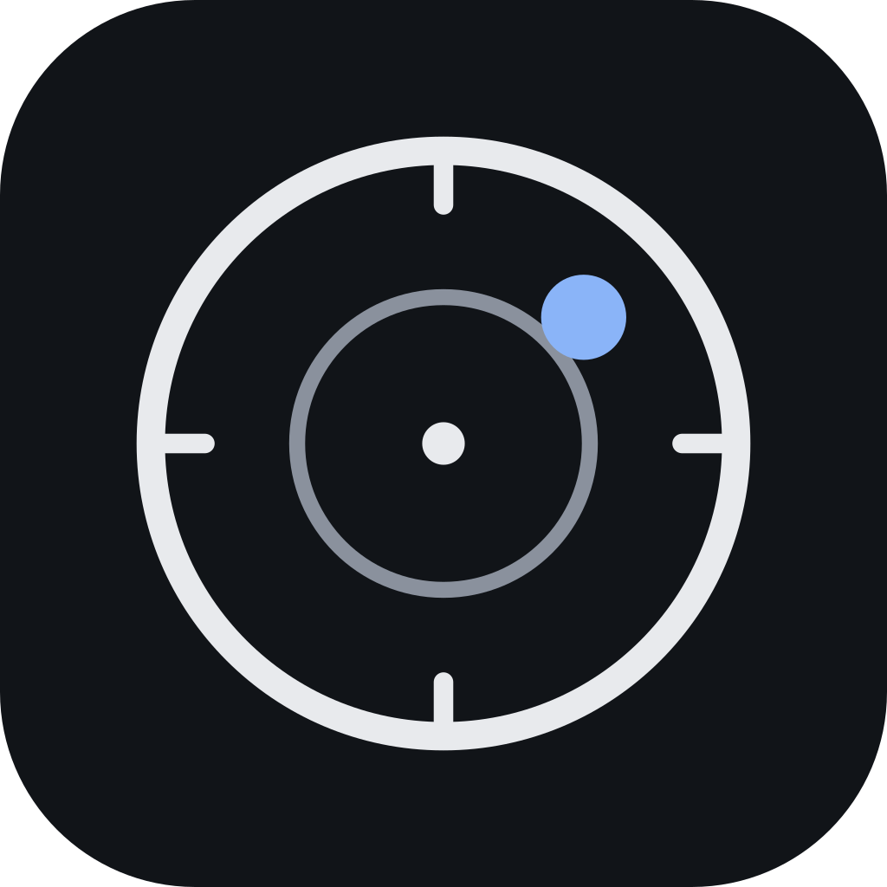
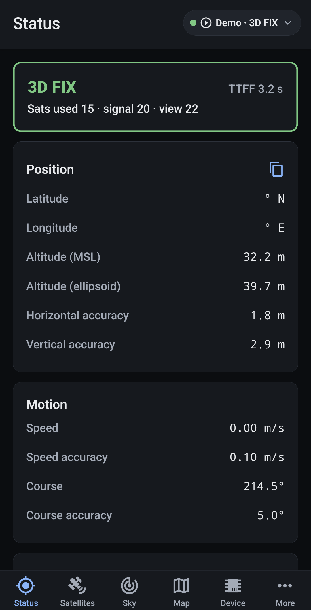
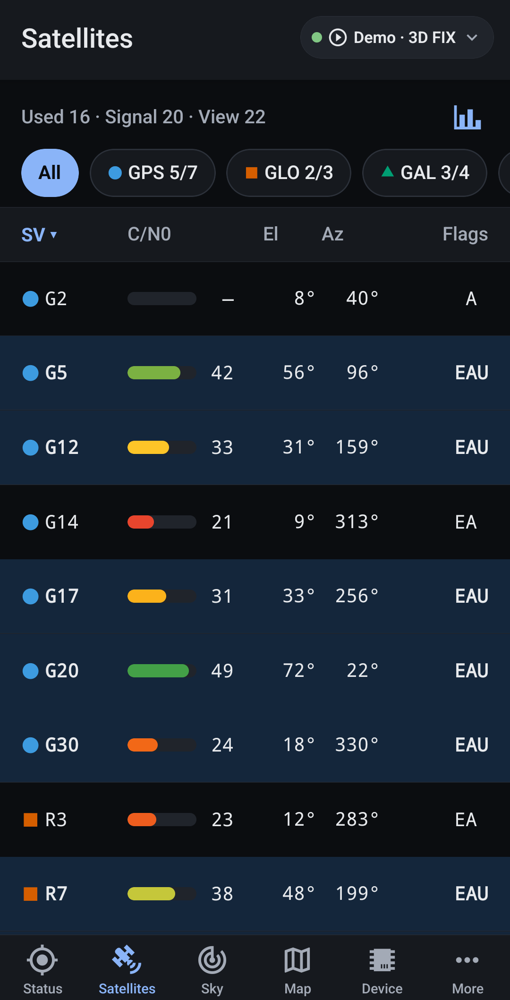
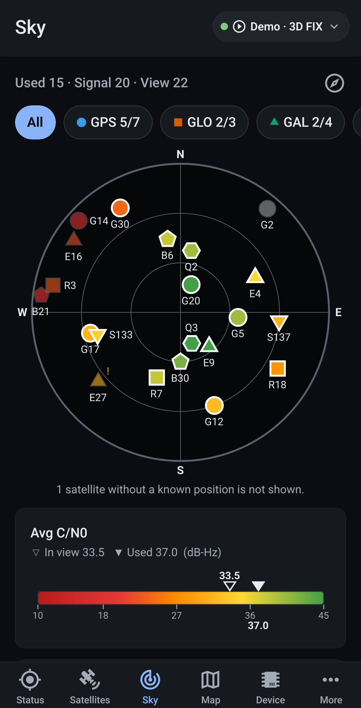
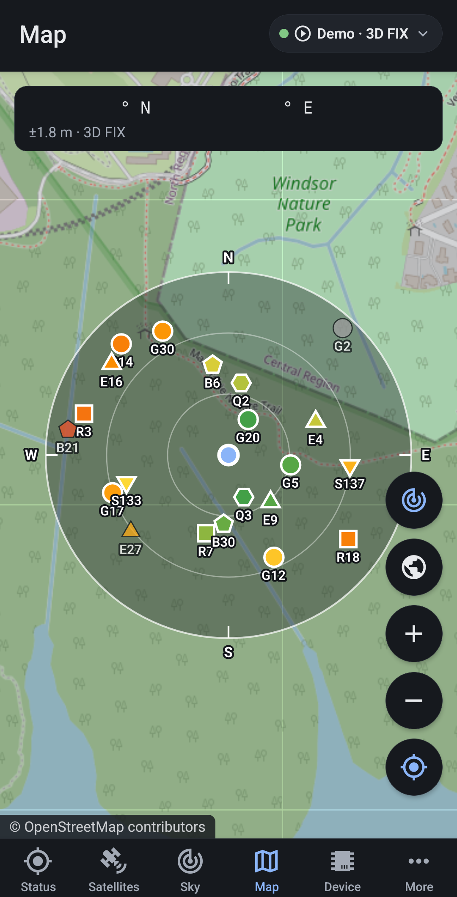
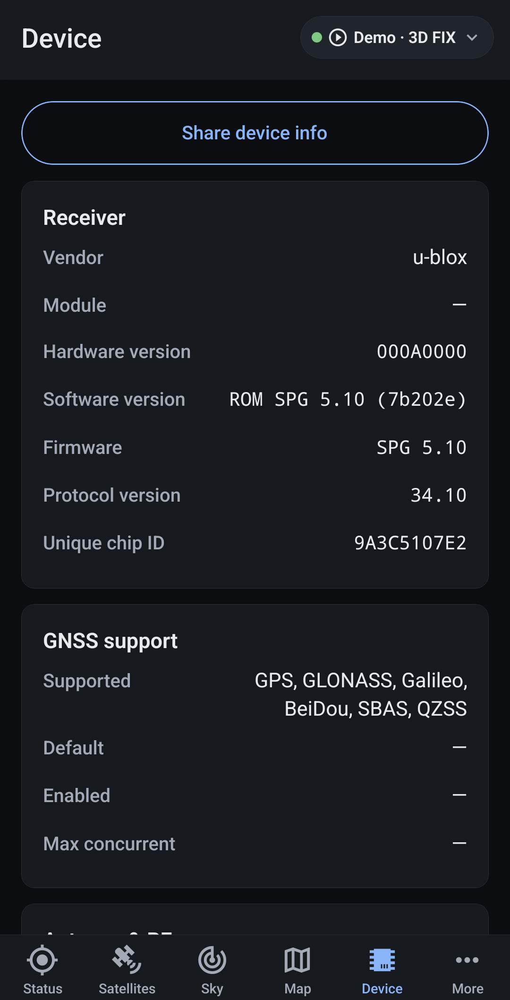
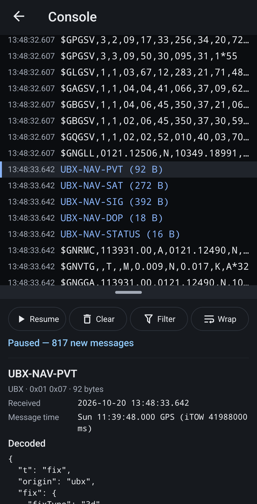
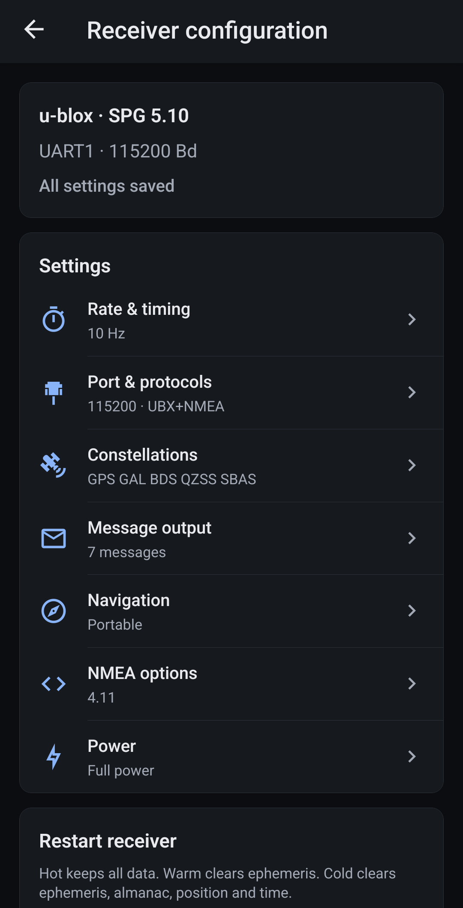
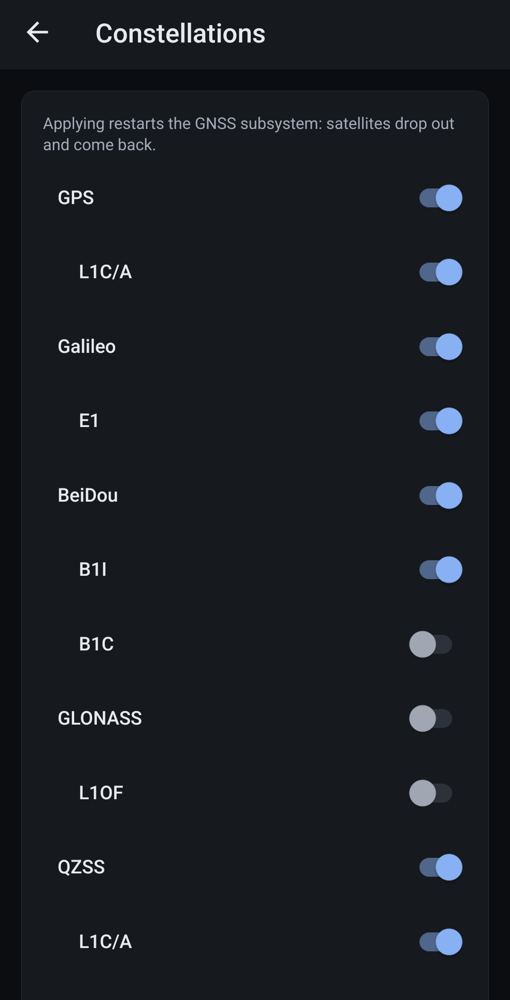
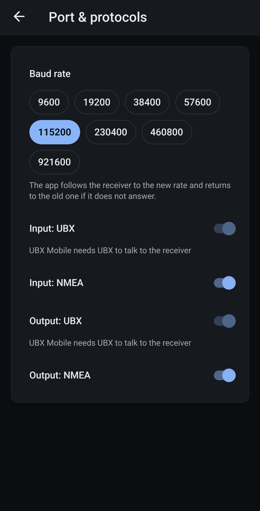

<p align="center">
  
</p>

<h1 align="center">UBX Mobile</h1>

<p align="center">
  GNSS monitoring, diagnostics and u-blox receiver configuration on an Android phone.
</p>

UBX Mobile shows what a GNSS receiver is doing: satellites, signal strength, sky positions, fix quality and receiver details. It works with the phone's built-in GNSS and with external receivers on USB, such as u-blox modules on a USB-to-serial adapter or a GPS behind a Betaflight/INAV flight controller. For u-blox receivers it can also change and save the receiver's configuration, so many things u-center is used for can be done in the field without a laptop.

## Features

- **Sources:** the phone's built-in receiver (Android Location/GNSS APIs); USB receivers through native USB or USB-UART bridges (CP210x, CH34x, FTDI, PL2303) with automatic baud-rate detection; Betaflight/INAV flight controllers through GPS passthrough; a built-in demo receiver.
- **Status:** position, altitude, speed, accuracy, DOP, time and validity, TTFF, plus u-blox extras (carrier solution, differential, leap seconds).
- **Satellites:** sortable and filterable list with C/N0, elevation/azimuth and flags; a signal strength chart; a u-center style wide table in landscape and on tablets; per-satellite details down to each signal.
- **Sky:** polar sky plot with constellation shapes and C/N0 colours, heading-up compass mode and satellite trails.
- **Map:** your position and track on OpenStreetMap, with a sky overlay around your position and the satellites' ground points.
- **Device:** receiver identity, firmware and protocol versions, supported constellations, antenna/RF status (jamming, AGC), USB adapter and stream statistics.
- **Console:** live NMEA/UBX/RTCM stream with filters, pause and decoded message details.
- **u-blox configuration** (generation 9 and later, e.g. M10): rates, ports and protocols, constellations, message output, navigation, NMEA and power settings. Changes are staged, applied to RAM and verified, then saved separately. Also restart (hot/warm/cold), revert, factory reset, backup and restore, and an editor for every configuration key.
- **Private and offline:** no accounts or analytics. Everything except the map tiles works without a network.

## Screenshots

<table>
  <tr>
    <td align="center"><br><sub>Status</sub></td>
    <td align="center"><br><sub>Satellites</sub></td>
    <td align="center"><br><sub>Sky</sub></td>
  </tr>
  <tr>
    <td align="center"><br><sub>Map with the sky overlay</sub></td>
    <td align="center"><br><sub>Device</sub></td>
    <td align="center"><br><sub>Console</sub></td>
  </tr>
  <tr>
    <td align="center"><br><sub>Receiver configuration</sub></td>
    <td align="center"><br><sub>Constellations</sub></td>
    <td align="center"><br><sub>Port &amp; protocols</sub></td>
  </tr>
</table>

<sub>Taken on a Samsung Galaxy A25: monitoring screens with the built-in demo receiver, configuration with a u-blox M10 module on USB.</sub>

## Hardware

- **Phone:** Android 8.0 (API 26) or newer. External receivers need USB host (OTG) support.
- **Receivers:**
  - Tested: Beitian BE-122 and BZGNSS BZ-251 (u-blox M10).
  - Any u-blox receiver works for monitoring; configuration needs generation 9 or later.
  - Generic NMEA receivers are monitored with fewer details.
- **Flight controllers:** Betaflight (4.5.x and 2025.12 tested) and INAV with a GPS attached, connected by the flight controller's USB port.

Wiring, power and baud-rate tips are in the app under **More → Help**.

## Development

### Prerequisites

- Node.js 22+
- JDK 17–21 (Android Studio's bundled JBR works: set `JAVA_HOME` to `<Android Studio>/jbr`)
- Android SDK (`ANDROID_HOME`, typically `%LOCALAPPDATA%\Android\Sdk` on Windows), with `platform-tools` (adb) on the `PATH`
- An Android phone with **USB debugging** enabled (Settings → Developer options)
- Windows only: long paths enabled (`LongPathsEnabled = 1`). The build pins CMake 3.31.6 (`plugins/withCmakeVersion.js`) because the default CMake 3.22.1 fails on long paths. Gradle installs it if missing; see the technical spec §12.

The app contains custom native code (USB serial, phone GNSS), so it runs in a **development build** and not in Expo Go.

### First build

```powershell
npm install
$env:JAVA_HOME = "C:\Program Files\Android\Android Studio\jbr"
npm run android
```

`npm run android` generates the native project, builds the debug app, installs it on the connected phone and starts the dev server (Metro). Build the app again whenever native code or `app.json` changes, for example after adding a native library, changing a config plugin or replacing the app icon. JavaScript changes only need a reload.

### Dev server

For day-to-day work, start Metro and open the installed development build:

```powershell
npm start
```

The phone must be able to reach Metro on port 8081. There are two ways.

**Over USB** (simplest; works on any network):

```powershell
adb reverse tcp:8081 tcp:8081
adb shell am start -a android.intent.action.VIEW -d "exp+ubx-mobile://expo-development-client/?url=http%3A%2F%2F127.0.0.1%3A8081"
```

Or, in the development build's launcher, choose *Enter URL manually* and enter `http://127.0.0.1:8081`. Run `adb reverse` again after every reconnect.

**Over Wi-Fi** (needed while the phone's USB port is used by a receiver):

1. Put the phone and PC on the same network.
2. Allow Metro through Windows Firewall once, in an administrator PowerShell:

   ```powershell
   New-NetFirewallRule -DisplayName "Expo Metro 8081" -Direction Inbound -Protocol TCP -LocalPort 8081 -Action Allow -Profile Private
   ```

3. If the PC has several network adapters (VPN, virtual machines), tell Metro which address to announce before starting it:

   ```powershell
   $env:REACT_NATIVE_PACKAGER_HOSTNAME = "192.168.0.9"   # the PC's Wi-Fi address
   npm start
   ```

4. In the launcher, enter `http://<PC address>:8081`. Opening `http://<PC address>:8081/status` in the phone's browser should show `packager-status:running`.

Shake the phone (or run `adb shell input keyevent 82`) to open the developer menu, for example to reload.

### Commands

| Command | Purpose |
|---|---|
| `npm install` | Install dependencies |
| `npm run android` | Build and install the debug app on a connected device, then start Metro |
| `npm start` | Start Metro for an already installed development build |
| `npm run prebuild` | Regenerate the `android/` project from `app.json` and config plugins |
| `npm run typecheck` | TypeScript check |
| `npm run lint` | ESLint + Prettier |
| `npm test` | Jest unit, component and screen tests |
| `npm run check` | Typecheck, lint and tests (what CI runs) |
| `npm run bench` | Decoding benchmark against the performance budget |
| `npm run licenses` | Regenerate the open-source licence list shown in About |
| `npm run release:apk` | Build the signed release APK ([docs/release.md](docs/release.md)) |

`android/` is generated (Continuous Native Generation) and not committed. Configure native behaviour through `app.json` and the config plugins in `plugins/`.

### Troubleshooting

- **"Gradle requires JVM 17 or later":** point `JAVA_HOME` at a JDK 17+, e.g. `$env:JAVA_HOME = "C:\Program Files\Android\Android Studio\jbr"`.
- **White screen, or stuck on "Connecting to development server":** the phone can't reach Metro. Use the USB route above, or check the firewall rule and `REACT_NATIVE_PACKAGER_HOSTNAME` for Wi-Fi. Don't start Metro with `--localhost`: on Windows it then listens on IPv6 only and the USB forward can't reach it.
- **"No USB serial devices found":** OTG may need to be switched on in the phone's settings. Some phones also need a powered hub for receivers.

### Project layout

```
src/
  app/            Expo Router routes (every file is a screen)
    (tabs)/       Status, Satellites, Sky, Map, Device, More
    config/       u-blox receiver configuration
  config/         Configuration keys, codec, rules, service, backups
  domain/         GNSS data model and pure helpers
  protocols/      NMEA / UBX / RTCM framing and decoding
  sources/        Phone, USB (incl. flight controller passthrough) and demo sources
  state/          Zustand stores (settings persisted in MMKV)
  ui/             Components, theme, sky plot, map, console
  i18n/           String catalogue (en.json)
  __tests__/      Screen-level tests (kept out of src/app so they are not routes)
modules/          Local Expo modules in Kotlin: android-gnss, usb-serial
plugins/          Expo config plugins (USB host, CMake version, release signing)
assets/logo/      Logo sources (generated by scripts/generate-logo.py)
docs/             Requirements, specifications, plan and release guide
```

## Documentation

- [Requirements](docs/requirements.md)
- [Functional specification](docs/functional-specifications.md)
- [Technical specification](docs/technical-specifications.md)
- [Implementation plan](docs/implementation-plan.md)
- [Release guide](docs/release.md)

## Credits

UBX Mobile was inspired by two excellent tools:

- **[GPSTest](https://play.google.com/store/apps/details?id=com.android.gpstest)** by Sean Barbeau, the reference for GNSS diagnostics on Android. Its status and sky views shaped the mobile layouts here.
- **u-center** by [u-blox](https://www.u-blox.com), the desktop evaluation software for u-blox receivers. Its satellite table, sky view and configuration view were the model for this app.

UBX Mobile was developed with **[Claude](https://claude.com/claude-code)** by Anthropic (Claude Code, Claude Opus 5.5), which helped write the specifications, code, tests and documentation.

UBX Mobile is an independent project. It is not affiliated with or endorsed by u-blox or the GPSTest project. u-blox and u-center are trademarks of u-blox AG.

Map data © [OpenStreetMap contributors](https://www.openstreetmap.org/copyright). USB serial support uses [usb-serial-for-android](https://github.com/mik3y/usb-serial-for-android) by mik3y. The full list of open-source components is in the app under **About → Open-source licences**.

## License

UBX Mobile is free software, licensed under the [GNU General Public License v3.0](LICENSE.md).
